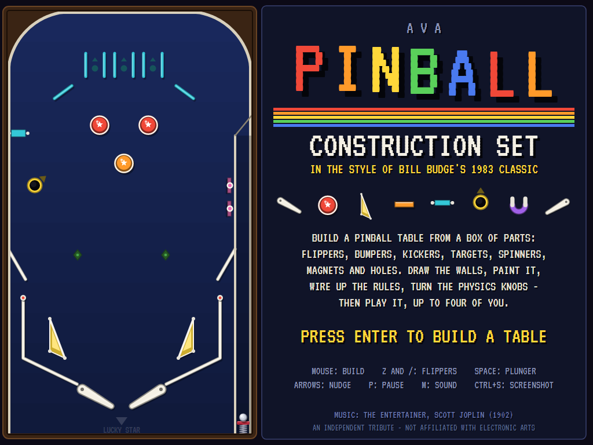
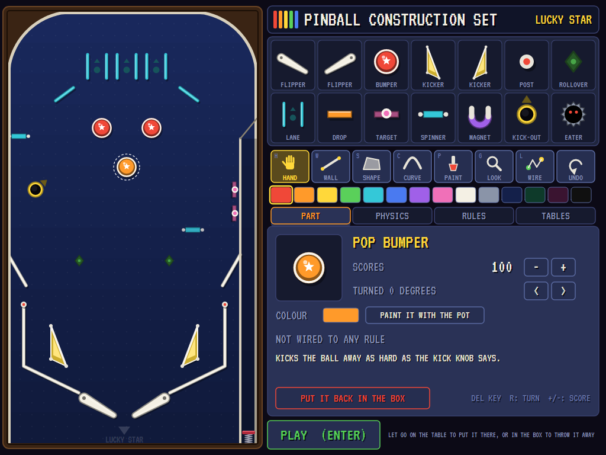
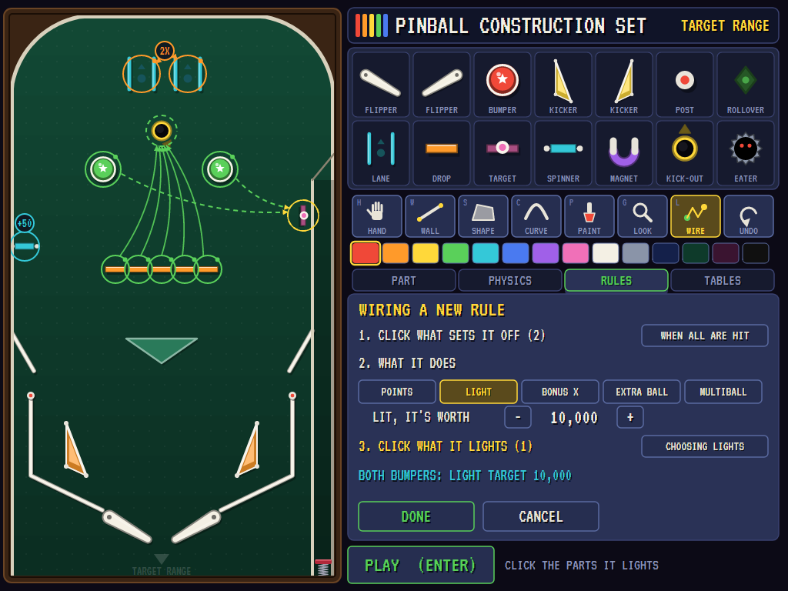
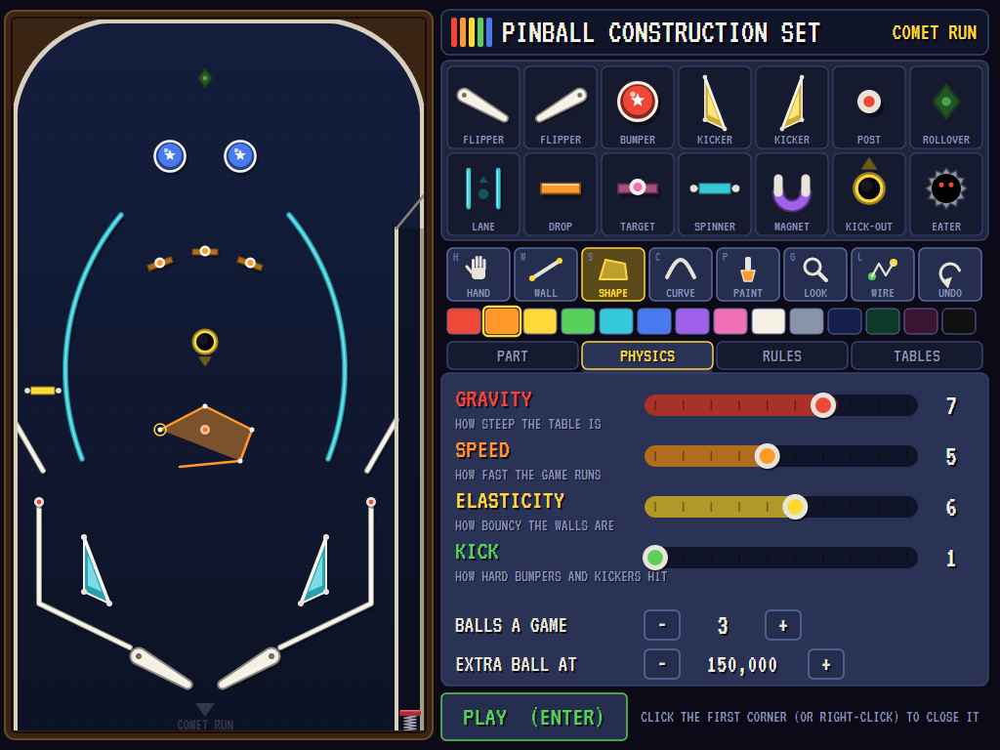
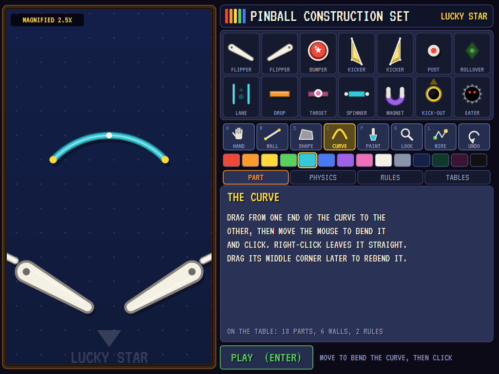
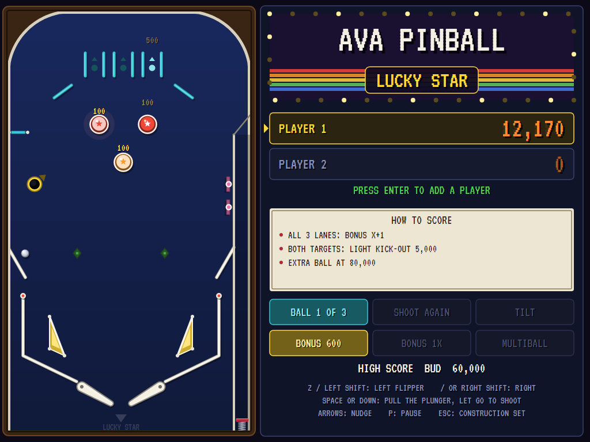
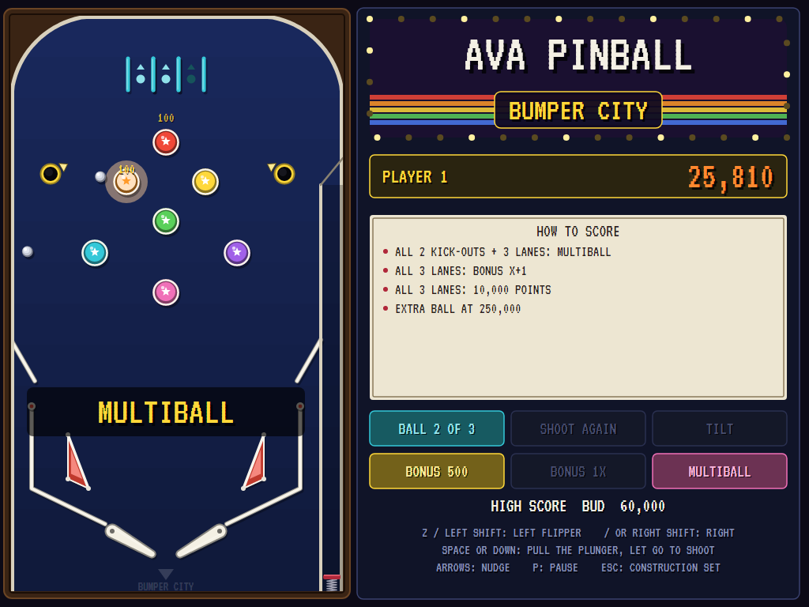
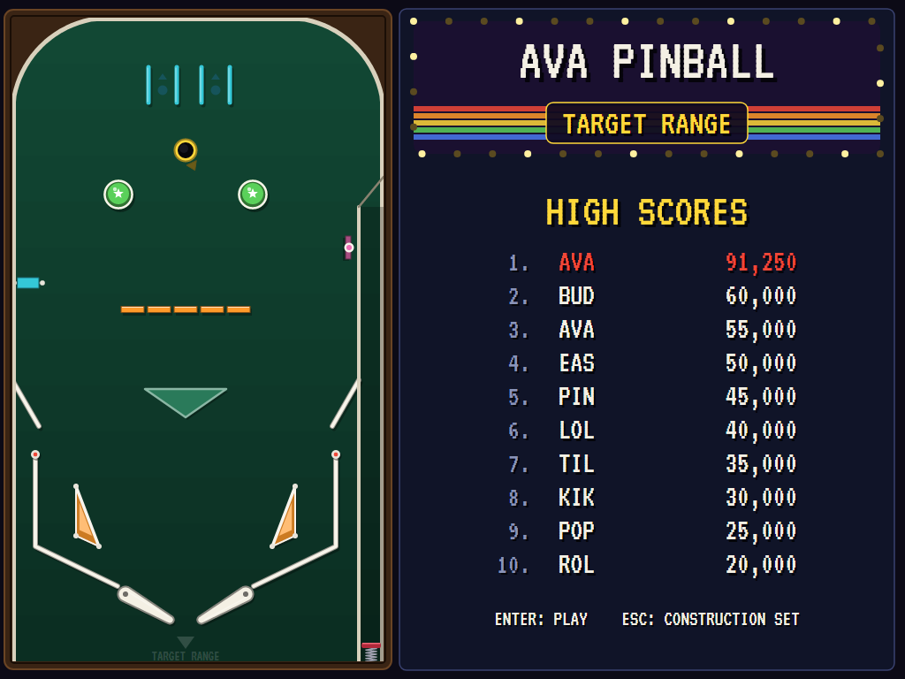

# AVA Pinball Construction Set

[](https://github.com/Harlock123/AVAPinballConstructionSet/actions/workflows/build.yml)

A pinball construction set in the style of Bill Budge's 1983 **Pinball Construction Set**, built with .NET 10 and
Avalonia UI. The table is on the left and the parts box on the right. Drag flippers, pop bumpers, kickers, targets,
spinners, magnets and holes onto the table. Draw the walls, paint everything, wire the parts together into rules,
and turn the knobs for gravity, speed, bounce and kick. Then play it, up to four of you, with a ball that never
slips through a wall however hard you hit it.

## Features

- **The parts box:** left and right flippers, pop bumpers, left and right kickers (slingshots), rubber posts,
  rollovers, rollover lanes, drop targets, standup targets, spinners, magnets, kick-out holes and ball eaters. Drag
  one from the box onto the table; drag it back into the box to throw it away.
- **The tools:**
  - **Hand:** pick a part up and move it, or a whole wall. Drag a wall's corner to reshape it. Click a part to set
    what it scores, turn it in steps of 15 degrees, or repaint it.
  - **Wall:** drag to draw a straight wall. Its ends snap to the corners of walls already there, so walls join up.
  - **Shape:** click corner by corner to draw a solid shape; click the first corner again (or right-click) to close it.
  - **Curve:** drag from one end to the other, then move the mouse to bend it and click.
  - **Paint:** fourteen paint pots, for any part, any wall, or the playfield itself.
  - **Look:** the magnifier, at 2.5 times, for close work. Every tool works magnified.
  - **Wire:** connects parts into rules.
  - **Undo**, sixty steps back.
- **Rules,** wired as in the original: pick the parts that set a rule off, any one of them or all of them. A part
  collected towards an "all of them" rule lights up until the set is done. Then choose what the rule does:
  - score points;
  - light other parts, which score extra the next time they're hit ("all five drop targets down: light the kick-out
    hole for 5,000");
  - raise the bonus multiplier;
  - give an extra ball;
  - start multiball, with up to three balls at once.

  The wires show on the table, and the backglass's instruction card spells out every rule in words.
- **The physics knobs,** each 1 to 10: **gravity** (how steep the table is), **speed** (how fast time runs),
  **elasticity** (how bouncy the walls are) and **kick** (how hard bumpers and kickers hit). There are also the
  balls a game (1 to 5) and the score that wins an extra ball.
- **Realistic ball physics:** a fixed-step simulation of a rigid ball with continuous collision detection. In each
  small step the ball moves to the first thing in its way (a line, a circle or an arc), bounces off it and goes on
  with the rest of the step. However fast it goes, it can't pass through a wall. The flippers are tapered bats that
  swing in small enough steps never to jump past the ball. They hit it with the speed of the point of the bat that
  touches it, so a ball near the tip goes faster. Gravity pulls it down the table, rubber is livelier than wall,
  and balls bounce off each other.
- **Play:** a plunger you pull back as far as you like, a one-way gate at the top of the shooter lane, nudging (too
  much too quickly and it's TILT), a bonus counted at the end of each ball and multiplied, extra balls, multiball,
  and 1 to 4 players taking turns. A ball left stuck where nothing can move it is kicked free, as real machines do.
- **High scores** for each table, with initials.
- **Five sample tables,** and a blank one:
  - **Lucky Star:** three top lanes for the multiplier, three bumpers, two targets that light the kick-out hole.
  - **Target Range:** a bank of five drop targets that lights the kick-out hole for 5,000, and a spinner.
  - **Magnet Mine:** two magnets, and a ball eater in the middle worth 2,500 if you dare.
  - **Comet Run:** curved walls round the sides, and three targets plus the kick-out hole for multiball.
  - **Bumper City:** seven bumpers, two kick-out holes and three lanes.
- **Files:** save a table under its name, as a small JSON file you can read, edit and share. The table you're
  working on is kept on disk as you go, so nothing is lost when the program closes.
- **The attract mode:** the computer plays the sample tables in turn. It pulls the plunger back a different way
  each ball, and flips when a ball over a flipper's bat is coming down onto it.

## Screenshots

| The title | The construction set | Wiring a rule |
|:---------:|:--------------------:|:-------------:|
|  |  |  |
| | A spinner on its way from the parts box. | Both bumpers: light the target for 10,000. |

| The physics knobs | Close work | Playing |
|:-----------------:|:----------:|:-------:|
|  |  |  |
| A shape being drawn, corner by corner. | A curved wall drawn under the magnifier. | Lucky Star, two players. |

| Multiball | High scores |
|:---------:|:-----------:|
|  |  |
| Bumper City. | Each table keeps its own. |

The screenshots are made by the tests, which drive the program with the mouse in a real (headless) window; see
[Tests](#tests).

## Download and run

Ready-to-run builds for Windows, macOS and Linux, on both Intel/AMD and ARM, are on the
[Releases page](https://github.com/Harlock123/AVAPinballConstructionSet/releases/tag/latest). **Latest build** is
rebuilt on every push to `main`. Each download is one self-contained executable: no .NET install is
needed.

| Platform | Archive |
|---|---|
| Windows | `AVAPinballConstructionSet-win-x64.zip`, `AVAPinballConstructionSet-win-x86.zip`, `AVAPinballConstructionSet-win-arm64.zip` |
| macOS | `AVAPinballConstructionSet-osx-arm64.tar.gz` (Apple silicon), `AVAPinballConstructionSet-osx-x64.tar.gz` (Intel) |
| Linux | `AVAPinballConstructionSet-linux-x64.tar.gz`, `AVAPinballConstructionSet-linux-arm64.tar.gz`, `AVAPinballConstructionSet-linux-arm.tar.gz` |

```bash
tar -xzf AVAPinballConstructionSet-linux-x64.tar.gz     # or linux-arm64, linux-arm, osx-arm64, osx-x64
./AVAPinballConstructionSet
```

On Windows, unzip and run `AVAPinballConstructionSet.exe`. On macOS, if Gatekeeper refuses to open it, run
`xattr -d com.apple.quarantine AVAPinballConstructionSet` once. Run with `--no-audio` for silence.

**Sound** comes through OpenAL Soft, built in for every platform. In a virtual machine the program
detects it and uses a larger audio buffer, so the sound doesn't break up.

**Gamepads** use SDL2, which is bundled for Windows, macOS and Intel/AMD Linux. ARM Linux builds need it
installed; without it the keyboard still works:

```bash
sudo apt install libsdl2-dev            # Debian / Ubuntu / Raspberry Pi OS
sudo pacman -S --needed sdl2-compat     # Arch / Omarchy
```

Saved tables are in your application-data folder (`~/.config/AVAPinballConstructionSet/tables` on Linux,
`%APPDATA%\AVAPinballConstructionSet\tables` on Windows), with the high scores beside them.

## Controls

**Building** is done with the mouse:

| Action | Mouse | Keyboard |
|---|---|---|
| Put a part on the table | Drag it from the parts box | |
| Move a part or a wall | Drag it with the hand | |
| Throw a part away | Drag it back into the parts box | Delete (the part chosen) |
| Choose a tool | Click it | H hand, W wall, S shape, C curve, P paint, G magnifier, L wire |
| Turn the part chosen | The arrows on the Part panel; Shift+wheel | R (Shift+R the other way) |
| Its score | The + and − on the Part panel | + and − |
| Choose a colour | Click a paint pot | |
| Finish a shape, straighten a curve | Right-click | Enter |
| Magnify | Click with the magnifier, or the mouse wheel | |
| Undo | The undo button | Ctrl+Z |
| Panels | Part, Physics, Rules, Tables | Tab |
| Play the table | PLAY | Enter |
| Back to the title | | Esc |

**Playing:**

| Action | Keyboard | Gamepad |
|---|---|---|
| Left flipper | Left Shift or Z | Left shoulder or trigger |
| Right flipper | Right Shift or / | Right shoulder or trigger |
| Plunger | Hold Space or Down, let go to shoot | Hold A or down on the D-pad |
| Nudge | Left, Right, Up | D-pad left, right, up (or X) |
| Add a player (on the first ball) | Enter | Start |
| Pause | P or Esc (Esc again: back to the construction set) | Start / Back |
| Sound on/off | M | |
| Screenshot | Ctrl+S (to your Pictures folder) | |

On the high-score table, type your initials, or use up/down and Space, then Enter.

## Tests

```bash
dotnet test AVAPinballConstructionSet.slnx
```

The game runs in fixed 60 Hz steps, so it plays the same at any frame rate. Everything in a game that moves or
changes lives in one world that can be copied. The tests check:

- **The physics:** where a moving ball first touches a line, a circle and an arc; a ball fired round a closed
  shape, round a ring of curved walls, and at a thin wall from both sides at top speed, never getting through; a
  ball fired down onto a flipper at top speed, resting or swinging up, bouncing off it; a flipper batting a
  resting ball up the table, and the right flipper swinging the other way; the gravity knob (the fall matching
  ½gt²), the speed knob and the kick knob; a dropped ball bouncing back about e² as high as it fell, and never
  higher; a ball never gaining energy off walls; balls bouncing off each other; the plunger, the gate and the ball
  search.
- **Every part:** the bumper's kick, the kickers' faces and backs, posts, rollovers (fast balls too), lanes, drop
  targets dropping and the bank coming back up, standups, turned targets, the spinner's turns, the magnet's grab,
  the kick-out hole's catch and kick, the ball eater, lit parts, and scores set in the construction set.
- **The rules:** any-one and all-of rules; drop targets lighting the kick-out hole; the bonus multiplier and its
  cap; extra balls; multiball and its limit; deleted parts leaving their rules; nothing scoring after a tilt; the
  rules as sentences.
- **The files:** a table with every part, wall, rule and knob coming back from its file exactly; the sample tables
  round-tripping and playing the same after; broken and hand-edited files; saving, listing and opening tables.
- **The construction set:** parts from the box; the hand moving them and the box taking them back; walls, shapes
  and curves; dragging a corner; paint; turning; scores; the magnifier; wiring a rule; the knobs; renaming; undo.
- **The game:** balls and players taking turns; joining on the first ball; the extra-ball mark; each ball starting
  afresh; the nudge and the tilt; the title, the demonstration and the high scores; playing from the construction
  set and pausing; initials for each player, and each table's own scores; the table kept on disk; a copied world
  going on as the original; the keys (Up through the keys nudges the ball up the screen); the computer at the
  flippers doing far better than no one; every sample table keeping the ball inside it.
- **The window:** a part dragged from the box with the mouse and back; the tool keys and buttons; drawing a wall;
  turning, scoring and deleting with the keys; dragging a knob; typing a table's name; the flippers, the plunger
  and pause with the keys; muting; typing initials; the mouse wheel; every screen drawing.

`tests/AVAPinballConstructionSet.Tests/PilotProbe.cs` reports how the computer player gets on, table by table, for
tuning (`PINBALL_PROBE=1`, `PINBALL_GAMES=10`). It keeps a ball alive from 20 seconds (Magnet Mine's ball eater)
to two minutes, and scores 15,000 to 500,000 a game. `PINBALL_PROBE=lazy` never flips, and loses every ball in
about ten seconds.

The screenshot tests draw the real screen in a headless window. To refresh the README's pictures:

```bash
PINBALL_SHOTS=$PWD/Images dotnet test tests/AVAPinballConstructionSet.Tests --filter ScreenshotTests
```

## Building

```bash
dotnet build AVAPinballConstructionSet.slnx
dotnet run --project src/AVAPinballConstructionSet
```

Needs the .NET 10 SDK. The sounds and music are made by `tools/make_sounds.py` (standard-library Python):
`python3 tools/make_sounds.py` rewrites `src/AVAPinballConstructionSet/Sounds`.

## Table files

A table is saved as `<name>.pinball.json` (shortened here; the real file is indented one value to a line):

```json
{
  "format": "AVAPinballConstructionSet table",
  "version": 1,
  "table": {
    "name": "LUCKY STAR",
    "playfield": "#14204A",
    "physics": { "gravity": 5, "speed": 5, "elasticity": 5, "kick": 5 },
    "balls": 3,
    "extraBallAt": 80000,
    "parts": [
      { "id": 1, "kind": "FlipperLeft", "x": 128, "y": 652, "angle": 0, "colour": "#F4F0E4", "score": 0, "points": [] },
      { "id": 3, "kind": "Wall", "x": 26, "y": 500, "angle": 0, "colour": "#F4F0E4", "score": 0,
        "points": [ { "x": 26, "y": 500 }, { "x": 26, "y": 598 }, { "x": 119, "y": 643 } ] },
      { "id": 11, "kind": "Lane", "x": 150, "y": 92, "angle": 0, "colour": "#34C8D8", "score": 500, "points": [] },
      ...
    ],
    "rules": [
      { "when": "All", "sources": [11, 12, 13], "effect": "Bonus", "targets": [], "amount": 0 },
      { "when": "All", "sources": [18, 19], "effect": "Light", "targets": [17], "amount": 5000 }
    ]
  }
}
```

The table is 420 by 728, with y running down the slope; the shooter lane is the strip right of x = 392. Walls
keep their corners in `points` (a curve is three: its ends and a point on the way); every other part stands at
`x`, `y`, turned clockwise by `angle` degrees. A file edited by hand is put right when it's loaded: parts are kept on
the table, the knobs in range, and rules to parts that aren't there are dropped.

## Project structure

```
AVAPinballConstructionSet/
├── AVAPinballConstructionSet.slnx
├── src/AVAPinballConstructionSet/
│   ├── Engine/
│   │   ├── GameEngine.cs        # States: the title, the demonstration, building, playing, high scores
│   │   ├── Editor.cs            # The construction set: the tools, the parts in hand, the wires, the knobs, undo
│   │   ├── Sim.cs               # The ball's physics, every part's behaviour, the rules, balls, players, tilt
│   │   ├── Geometry.cs          # Lines, circles and arcs, and a moving ball against them
│   │   ├── Table.cs             # Tables, parts, rules and knobs, and their JSON files
│   │   ├── World.cs             # A game in progress, kept so it can be copied
│   │   ├── Samples.cs           # The five sample tables and the blank one
│   │   ├── Pilot.cs             # The computer at the flippers, for the demonstration
│   │   ├── HighScoreTable.cs, InitialsEntry.cs
│   │   ├── InputHandler.cs, ControllerManager.cs  # Keys and an SDL2 gamepad
│   │   └── SoundManager.cs      # Effects and music through OpenAL
│   ├── Audio/                   # The OpenAL engine (from the author's AVABand)
│   ├── Views/GameCanvas*.cs     # The table and every part, the parts box, the tools and panels, the backglass
│   └── Sounds/                  # The synthesised effects and music
├── tests/AVAPinballConstructionSet.Tests/     # Physics, parts, rules, files, editor, game, window and screenshot tests
├── tools/make_sounds.py
└── Images/                      # Screenshots
```

## About and licence

AVA Pinball Construction Set © 2026 Lonnie Watson, under the [MIT License](LICENSE).

*Pinball Construction Set* © 1983 Bill Budge / Electronic Arts. AVA Pinball Construction Set is an independent,
unofficial program in its style. Its graphics, sounds, sample tables and code are its own; nothing is taken from
the original program, its graphics, its sound or its tables. It is not affiliated with or endorsed by Bill Budge,
Electronic Arts or any other rights holder. The title music is *The Entertainer* by Scott Joplin (1902), in the
public domain, played by the program's own synthesiser; every other sound is its own.
